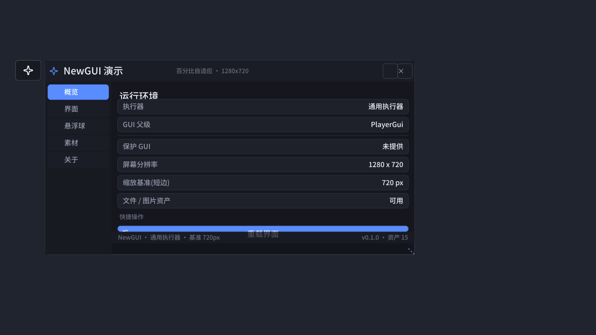
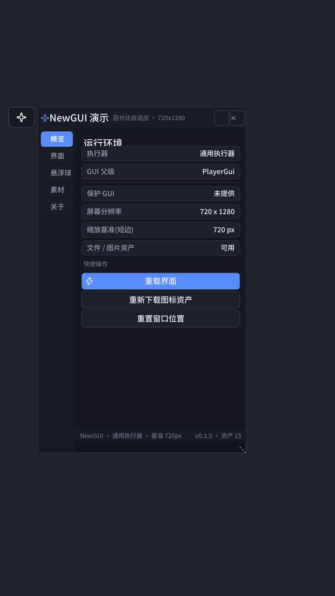
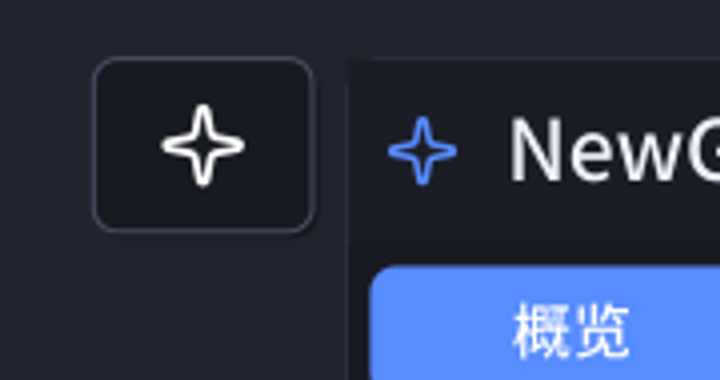
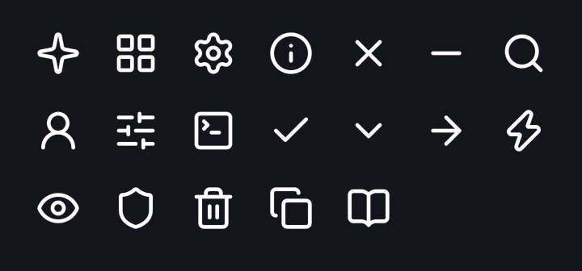

# NewGUI

面向 **Roblox 客户端执行器** 的轻量 UI 库：长方形悬浮球 + 主窗口 + 控件库，
**所有控件按屏幕百分比自适应**，圆角/字号/描边等像素细节用"像素风小圆角"统一管理。

- 适配执行器：Synapse X / Script-Ware / Krnl / Fluxus / Wave / Hydrogen(Nihon) / Electron / Solara / 通用执行器（自动探测 `gethui`、`protect_gui`、`request`、`getcustomasset` 等能力，逐级回退，无执行器时降级到 `PlayerGui` 也能跑）
- 界面不依赖任何外部 UI 库：自研信号、缩放、主题、控件体系，纯 Lua 实现
- 图标：仓库自带 PNG（Lucide，ISC 许可）+ 离线矢量回退，**没有一个 emoji**
- 源码模块化，`tools/build.py` 打包成单文件，执行器一句 `loadstring` 直接用



手机竖屏（720×1280，同一套代码，自动跟随）：



---

## 一键加载

```lua
-- 完整界面(悬浮球 + 主窗口)
loadstring(game:HttpGet("https://raw.githubusercontent.com/aa121314aa/new-GUI/main/dist/NewGUI.lua"))()

-- 只拿库，不要自动弹界面(自己控制启动时机)
local NewGUI = loadstring(game:HttpGet("https://raw.githubusercontent.com/aa121314aa/new-GUI/main/dist/library.lua"))()
NewGUI.start({ title = "我的脚本", subtitle = "v1.0" })
```

首次运行会把这些东西写到执行器工作目录（之后不再联网）：

```
NewGUI/settings.json                 -- 窗口/悬浮球位置、主题等
NewGUI/assets/icons/*.png            -- 图标(用于 getcustomasset)
```

---

## 悬浮球

按需求做的"简单长方形 + 像素风小圆角"：

| 参数 | 默认值 | 含义 |
| --- | --- | --- |
| `Config.orb.width` | `7.6` | 宽 = **基准轴（屏幕短边）的 7.6%** |
| `Config.orb.height` | `6.0` | 高 = 基准轴的 6.0%（长方形，宽 > 高）|
| `Config.orb.corner` | `0.85` | 圆角 = 基准轴的 0.85%（720p 下约 6px，克制的像素圆角）|
| `Config.orb.iconSize` | `3.1` | 图标边长 = 基准轴的 3.1% |

放大看（720p 下实测 55×43px，圆角约 6px）：



- 可拖动：位移超过 4px 才算拖动，松手才判定点击 —— 拖动不会误触打开窗口
- 位置按**视口百分比**保存，换分辨率/转屏后仍在原相对位置；超出边界会自动钳制
- 图标优先用 PNG（可被 `ImageColor3` 染色），拿不到就自动换成内置矢量图标

改这些值可以实时看到效果：主界面「悬浮球」页有宽度/高度/圆角/图标大小的滑条。

---

## 百分比缩放系统

这是整套 UI 的地基，只有两个概念，写控件时必须分清：

| 概念 | 用在哪 | 写法 |
| --- | --- | --- |
| **基准轴百分比** | 绝大多数"尺寸"（悬浮球、按钮高度、字号、圆角、描边、间距）| `Scale.px(4.4)` → 像素值；`Scale.u(4.4)` → `UDim` |
| **视口百分比** | 窗口宽高、悬浮球/窗口的位置 | `UDim2.fromScale(0.62, 0)` 或 `Scale.viewportPosition(x%, y%)` |

> 基准轴 = `min(视口宽, 视口高)`。手机竖屏时是宽，电脑/平板横屏时是高 —— 所以同一套数值在两种朝向都合适。

屏幕变化时（改分辨率、转屏、窗口缩放）`Scale.Changed` 触发，所有像素细节重算一次：

```lua
-- 任意像素属性都能绑定成"随屏幕百分比变化"
Scale.bind(myLabel, function()
    return { TextSize = Scale.font(2.45) } -- 2.45% 基准轴, 自带 9~34px 钳制
end)

-- 控件尺寸
Scale.bindSize(myButton, 14, 4.4)     -- 宽 14%、高 4.4% 基准轴
Theme.corner(myButton, "control")     -- 圆角走令牌, 自动跟随
Theme.stroke(myButton, nil, 0.14)     -- 描边厚度也是百分比
Theme.padding(myButton, 1.0)          -- 内边距也是百分比
```

护栏（极端分辨率下不至于难看/看不清）：

- 字号：`Scale.minFontPx = 9` ~ `Scale.maxFontPx = 34`
- 窗口：`minWidth/minHeight`（视口 %）与 `maxWidth/maxHeight` 双向钳制
- 侧边栏宽度在 `11% ~ 22%` 基准轴之间自适应，窄屏只留图标

---

## 自定义页面

```lua
local NewGUI = loadstring(game:HttpGet(".../dist/library.lua"))()
local handle = NewGUI.start({ title = "我的脚本" })
local W = NewGUI.Widgets

handle:AddPage({
    name = "自动化",
    icon = "bolt",                 -- 图标名见下表
    build = function(scroll, window, ctx)
        W.label(scroll, "参数设置", { font = "title" })

        W.toggle(scroll, {
            text = "自动采集",
            icon = "eye",
            default = false,
            changed = function(value) print("自动采集 =", value) end,
        })

        W.slider(scroll, {
            text = "速度", min = 1, max = 50, step = 1, default = 10, suffix = "%",
            changed = function(value) print("速度 =", value) end,
        })

        W.button(scroll, "立即执行", {
            icon = "bolt", variant = "primary",
            callback = function() ctx.notify({ title = "已执行", kind = "success" }) end,
        })
    end,
})
```

内置控件（全部百分比尺寸，`Widgets.*`）：`label` `separator` `list` `scroll` `button` `iconButton`
`toggle` `slider` `dropdown` `input` `keybind` `tabs` `badge` `section`

完整 API 见 [docs/API.md](docs/API.md)。

---

## 图标与资产

- 图标来源：[Lucide](https://lucide.dev)（ISC 许可），已光栅化为 **128px 白色描边 PNG**（透明底）
  - 白色是为了在 Roblox 侧用 `ImageColor3` 染色，一张图适配所有主题色
  - 生成脚本：`node tools/make_icons.mjs`，映射表 `tools/icon-map.json`
- 运行时加载顺序：**本地缓存 → 仓库 raw 下载 → 内置矢量图标**，断网也不会崩
- 内置矢量图标（`Core/Glyph.lua`）连 SVG 路径都自带解析器，`sparkle / grid / settings / info /
  close / minimize / search / player / sliders / terminal / check / chevron / arrow / bolt /
  eye / shield / trash / copy / book` 全部有矢量版，也支持 Lucide 原名（`zap`、`x`、`trash-2`…）



> 想换图标：把 PNG 放进 `dist/assets/icons/`，然后在 `Config.assets.icons` 里加一行映射即可
> （同名文件会被执行器缓存目录里的旧文件覆盖，必要时用界面里的"清空本地图标缓存"）。

---

## 目录结构

```
src/                         源码(模块化)
  Core/Compat.lua            执行器适配层(能力探测/HTTP/文件/gethui/保护 GUI)
  Core/Scale.lua             百分比缩放系统(基准轴换算 + 变化重算)
  Core/Theme.lua             配色 + 圆角/尺寸令牌
  Core/Config.lua            运行参数(悬浮球/窗口/资产/行为)
  Core/Assets.lua            图片资产: 缓存 → 下载 → 矢量回退
  Core/Glyph.lua             矢量图标 + SVG 路径解析器
  Core/Signal.lua            事件系统
  Core/Storage.lua           配置持久化(节流写入)
  Components/Orb.lua         悬浮球
  UI/Window.lua              主窗口(标题栏/侧边栏/内容区/状态栏/拖动/缩放)
  UI/Widgets.lua             控件库
  UI/Pages.lua               内置页面
  UI/Notify.lua              轻提示
  init.lua                   入口(默认自动启动)
dist/                        发布产物(执行器直接加载)
  NewGUI.lua                 完整脚本(自带启动)
  library.lua                只含库(不自动启动)
  assets/icons/*.png         图标资产
tools/                       开发工具(不参与运行时)
  build.py                   打包 src → dist
  sim.py                     端到端模拟(桩环境跑真实构建流程 + 断言)
  roblox_stub.lua            Roblox 环境桩(模拟器用)
  preview.py / mock_render.lua  布局预览渲染(SVG/PNG)
  make_icons.mjs             图标光栅化
docs/API.md                  API 文档
```

---

## 开发与自测

```bash
python3 tools/build.py          # 打包 → dist/NewGUI.lua、dist/library.lua
python3 tools/sim.py            # 端到端模拟: 启动/转屏/资产/存盘/重建/卸载 + 断言
python3 tools/sim.py --offline  # 验证断网时自动回退矢量图标
python3 tools/sim.py --autostart # 验证 dist/NewGUI.lua 自带启动路径
python3 tools/preview.py        # 渲染预览图(桌面)
python3 tools/preview.py --size 720x1280 --name phone

cd tools && npm install         # 仅工具链需要 sharp
node fetch_fonts.mjs            # 预览图用的中文字体(可选, 沙箱里没字体时装)
node make_icons.mjs             # 重新生成图标资产
```

`tools/sim.py` 会在本地桩环境里真的跑一遍完整流程（含 HTTP 下载图标、写文件、
切页面、改分辨率），任何运行时错误都会让脚本以非 0 退出，适合放进 CI。

一次性全跑：

```bash
bash ci/verify.sh
```

> 想让 GitHub Actions 自动跑：把 `ci/github-actions.yml` 复制成
> `.github/workflows/build.yml` 即可（本仓库的 GitHub App 没有 workflows 权限，
> 所以默认放在 `ci/` 下不会生效，需要你手动启用一次）。

---

## 许可

- 本项目代码：按你的需求放在本仓库，可自由修改
- 图标资产：[Lucide](https://lucide.dev)，ISC License（`dist/assets/icons/manifest.json` 记录了来源与版本）
- 预览图字体（不进入仓库）：[Noto Sans SC](https://github.com/notofonts/noto-cjk)，SIL OFL 1.1
